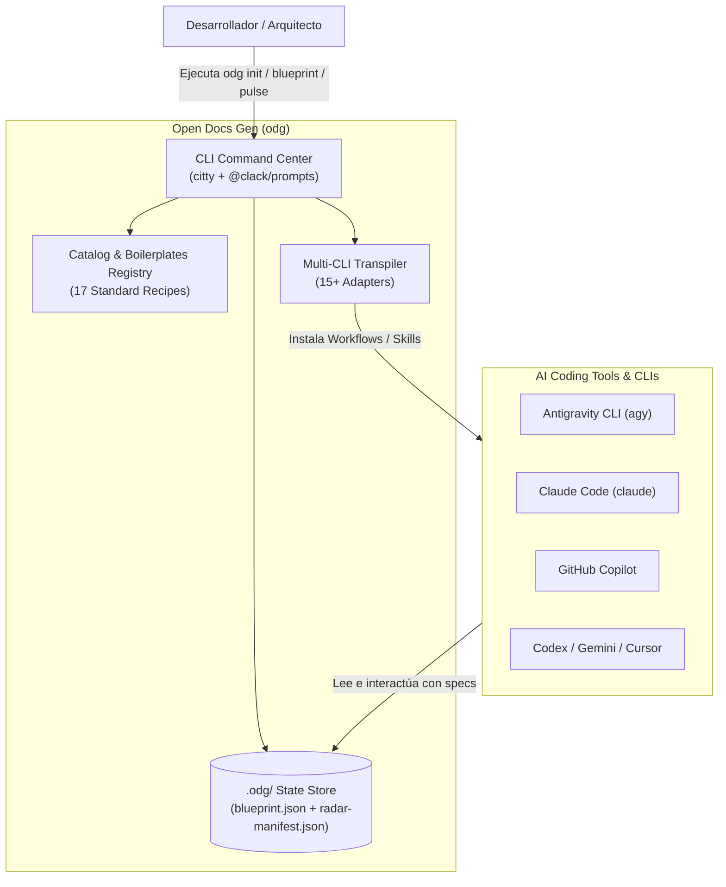

# C4 Context & Container Diagram — Open Docs Gen (`odg`)

## 1. System Boundary Overview
`odg` opera como el orquestador central local que analiza la base de código del usuario, gestiona el estado en `.odg/` y expone capacidades hacia herramientas de IA externas y la interfaz de usuario local.

## 2. Interactive C4 Context Diagram

## 3. Container & Services Inventory
| Container / Service | Technology | Responsibility | Data Store / Port |
| :--- | :--- | :--- | :--- |
| **CLI Runner** | Node.js (citty) | Punto de entrada de comandos de terminal interactivos. | CLI args |
| **Catalog Engine** | TypeScript | Almacena definiciones canónicas de diagramas y documentos. | In-memory |
| **Integrations Transpiler** | TypeScript / FS | Escribe los comandos `/odg` y skills para cada CLI de IA. | Local files (`.agents/`, `.claude/`, etc.) |
| **Artifacts Repository** | File System (Markdown + JSON) | Mantiene el estado incremental y documentación humana/IA. | `.odg/` |

<!-- odg:refs:start -->
## 4. Cross-References
| Container | Domain Modules | External APIs | Status |
| :--- | :--- | :--- | :--- |
| CLI Runner | `[[mod:cli]]` | Terminal `odg` | 🟢 Full Spec |
| Catalog Engine | `[[mod:catalog]]` | Types & Recipes | 🟢 Full Spec |
| Transpiler | `[[mod:integrations]]` | AI Tool Files | 🟢 Full Spec |
<!-- odg:refs:end -->
