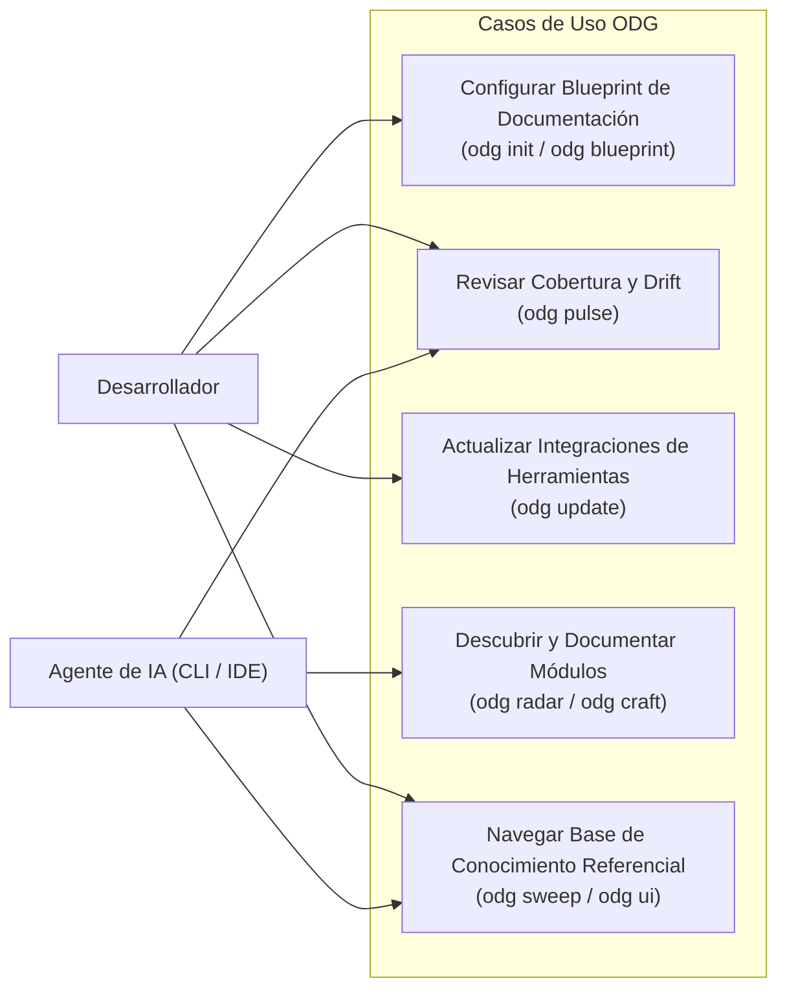

# Use Case Diagram — Open Docs Gen (`odg`)

## 1. System Capabilities & Actors
El sistema contempla dos actores principales: el **Desarrollador / Usuario Humano** y el **Agente de IA (CLI / Copilot / IDE)**.

## 2. Interactive Use Case Diagram

## 3. Actor Capabilities Matrix
| Actor / Role | Permitted Use Cases | Preconditions | Auth Guard |
| :--- | :--- | :--- | :--- |
| Desarrollador | Configurar Blueprint, Revisar Cobertura, Actualizar Herramientas | Node.js instalado, repositorio local | CLI / Local permissions |
| Agente de IA | Consultar Radar, Generar Módulos, Resolver Referencias | Archivos de comandos y skills instalados | File access |

<!-- odg:refs:start -->
## 4. Cross-References
| Use Case | Associated Requirement | Triggering Route | Status |
| :--- | :--- | :--- | :--- |
| Configurar Blueprint | `[[req:FR-01-blueprint]]` | `odg blueprint` | 🟢 Full Spec |
| Revisar Cobertura | `[[req:FR-02-pulse]]` | `odg pulse` | 🟢 Full Spec |
| Sincronizar Herramientas | `[[req:FR-03-update]]` | `odg update` | 🟢 Full Spec |
<!-- odg:refs:end -->
