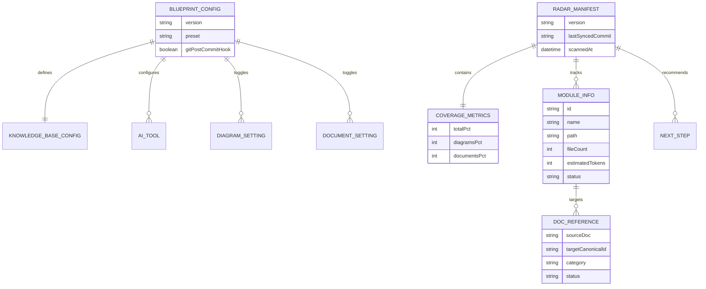

# Entity-Relationship Diagram (ERD) — Modelo de Estado y Configuración

## 1. Architectural Data Model Overview
El modelo de datos y estado de `odg` estructura la configuración del usuario en `.odg/blueprint.json`, el manifiesto de cobertura en `.odg/radar-manifest.json` y el grafo relacional de referencias cruzadas.

## 2. Interactive Entity-Relationship Diagram

## 3. Relationships & Cardinality Matrix
| Parent Entity | Child Entity | Cardinality | Foreign Key / Join | Cascade & Integrity Rule |
| :--- | :--- | :--- | :--- | :--- |
| `BLUEPRINT_CONFIG` | `DIAGRAM_SETTING` | 1 to Many | `preset` / `id` | Siempre inicializa los 8 diagramas estándar |
| `BLUEPRINT_CONFIG` | `DOCUMENT_SETTING` | 1 to Many | `preset` / `id` | Siempre inicializa los 9 documentos estándar |
| `RADAR_MANIFEST` | `MODULE_INFO` | 1 to Many | `module_id` | Se actualiza en cada escaneo incremental |
| `MODULE_INFO` | `DOC_REFERENCE` | 1 to Many | `targetCanonicalId` | Conexión bidireccional en DuckDB / Markdown |

<!-- odg:refs:start -->
## 4. Cross-References
| Table | Module Owner | Associated Requirements | Status |
| :--- | :--- | :--- | :--- |
| `BLUEPRINT_CONFIG` | `[[mod:catalog]]` | `[[req:FR-01-blueprint]]` | 🟢 Full Spec |
| `RADAR_MANIFEST` | `[[mod:cli]]` | `[[req:FR-02-pulse]]` | 🟢 Full Spec |
| `DOC_REFERENCE` | `[[mod:catalog]]` | Base de Conocimiento Referencial | 🟢 Full Spec |
<!-- odg:refs:end -->
