<div align="center">

# 🌐 Open Docs Gen (`odg`)
### Zero-Waste Software Architecture Documentation & Living Portal Engine

[](https://www.npmjs.com/package/open-docs-gen)
[](LICENSE)
[](https://nodejs.org/)
[](https://mermaid.js.org/)
[](#-ai-assistant--multi-cli-integrations)

**Open Docs Gen (`odg`)** is a developer-first, open-source architecture documentation framework. It turns any codebase into an interactive, high-definition living architecture portal with **zero token waste**. 

Combining **0-token deterministic AST discovery** with targeted LLM synthesis and an embedded dark-mode web application, `odg` eliminates stale documentation and token bloat forever.

[Quickstart](#-quickstart-in-3-steps) • [Architecture Suite](#-the-architecture-suite) • [Documentation Hub](docs/getting-started.md) • [CLI Reference](docs/cli-reference.md) • [Living Portal Guide](docs/portal-guide.md)

</div>

---

## ✨ Key Capabilities

* 🔍 **0-Token Module Discovery (`odg radar`):** Crawls directory trees, routes, controllers, and models deterministically without consuming a single LLM token.
* 📐 **Mermaid v11 Interactive Diagrams:** Generates high-contrast C4 Component, ERD, Use Case, and Sequence Flow diagrams with built-in text contrast halo shields and pan-and-zoom modals.
* 📄 **Complete Written Architecture Suite:** Automatically structures Technical SOWs, Software Requirements Specifications (SRS), API Contract Catalogs, Data Dictionaries, and Operational Runbooks.
* 🌐 **Embedded Living Portal (`odg ui`):** Instant, zero-config local SPA to inspect, search, and zoom into diagrams and markdown specs.
* 🤖 **Multi-CLI & AI Agent Native:** One-command installation of native slash commands (`/odg-craft`, `/odg-radar`, `/odg-pulse`) for **Google Antigravity CLI (`agy`)**, **Claude Code**, and **GitHub Copilot**.
* 🧹 **Automated Link Reconciler (`odg sweep`):** Keeps cross-document references, requirement IDs, and bidirectional traceability links in sync.

---

## 🚀 Quickstart in 3 Steps

### 1. Install Globally
```bash
# Directly from GitHub (recommended)
npm install -g git+https://github.com/irondead5/odg.git

# Or from npm registry (once published)
npm install -g open-docs-gen
# or with pnpm:
pnpm add -g open-docs-gen
```

### 2. Initialize in Your Codebase
Navigate to any project repository and run the setup wizard:
```bash
odg init
```
Select your preferred preset (**Recommended Standard**, **Full Enterprise**, **Lean/MVP**, or **Custom**) and choose your AI tools.

### 3. Scan, Craft & Explore
```bash
# 1. Discover modules & estimate token budget (0 tokens)
odg radar

# 2. Deep synthesize architecture documentation
odg craft --all

# 3. Launch the living documentation portal
odg ui
```
Open **`http://localhost:4321`** in your browser to view your complete living architecture portal.

---

## 🏛️ How It Works: The 2-Pillar System

```mermaid
flowchart LR
    subgraph S1 ["Pillar 1: Visual Diagrams (Mermaid.js)"]
        ERD["ERD & Schemas"]
        C4["C4 Context & Component"]
        UC["Use Case Flows"]
        SEQ["Sequence Flows"]
    end

    subgraph S2 ["Pillar 2: Written Specs (Markdown)"]
        SOW["01-overview / Technical SOW"]
        SRS["02-requirements / SRS"]
        DOM["03-domains / Module Specs"]
        API["04-api / API Contracts"]
        DATA["05-data / Data Dictionary"]
        OPS["06-ops / Env Runbook"]
    end

    S1 <-->|"Traceability Matrix (odg sweep)"| S2
    style S1 fill:#090e1a,stroke:#38bdf8,stroke-width:2px,color:#fff
    style S2 fill:#090e1a,stroke:#60a5fa,stroke-width:2px,color:#fff
```



### Pillar 1: High-Contrast Diagrams (Mermaid v11)
* **Entity-Relationship Diagrams (ERD):** Tables, typed columns, PK/FK relationships, and hollow cardinality rings (`||--o{`) that never obscure connector labels.
* **C4 Component Diagrams:** System boundaries, external identity providers (Auth0), databases, and internal API routers.
* **Use Case Diagrams:** Bounded domain contexts and rounded actor nodes (`UserActor((...))`) with vibrant cyan borders (`#38bdf8`).
* **Sequence Flows:** Request/response lifelines with autonumbering, compensating rollback actions, and error handling (`alt/else`).

### Pillar 2: Written Architecture Specifications
All documentation lives in your repository under `.odg/human/`:
* 📘 [`01-overview/technical-sow.md`](docs/architecture-suite.md#1-01-overviewtechnical-sowmd-technical-scope-of-work): Scope of work, technology stack matrix, and deliverables.
* 📋 [`02-requirements/requirements-srs.md`](docs/architecture-suite.md#2-02-requirementsrequirements-srsmd-software-requirements-specification): Actors, access matrix, functional requirements (`FR-*`), and NFRs.
* 🏛️ [`03-domains/<module>.md`](docs/architecture-suite.md#3-03-domainsmodulemd-deep-module-specifications): Deep module architecture, repository contracts, and all 4 diagrams.
* 🔌 [`04-api/api-contracts.md`](docs/architecture-suite.md#4-04-apiapi-contractsmd-api--contract-catalog): Endpoints, methods, DTO schemas, and auth guards.
* 🗄️ [`05-data/data-dictionary.md`](docs/architecture-suite.md#5-05-datadata-dictionarymd-database--data-dictionary): Table columns, data types, nullability, and database indexes.
* ⚙️ [`06-ops/env-runbook.md`](docs/architecture-suite.md#6-06-opsenv-runbookmd-operational-runbook--environment): Environment variables catalog, secrets rotation, and startup guides.

---

## 🛠️ CLI Command Reference

| Command | Purpose | Details |
| :--- | :--- | :--- |
| `odg init` | Interactive setup wizard & preset selector | [Guide](docs/cli-reference.md#odg-init) |
| `odg radar` | Deterministic module scanner & budget estimator (`0 tokens`) | [Guide](docs/cli-reference.md#odg-radar) |
| `odg craft <target>` | Deep architectural synthesis for modules or docs | [Guide](docs/cli-reference.md#odg-craft) |
| `odg pulse` | Instant coverage % audit and drift healthcheck | [Guide](docs/cli-reference.md#odg-pulse) |
| `odg sweep` | Reconciles cross-document references & backlinks | [Guide](docs/cli-reference.md#odg-sweep) |
| `odg ui` | Starts the embedded living architecture portal | [Guide](docs/cli-reference.md#odg-ui) |
| `odg blueprint` | View or toggle active diagrams and documents | [Guide](docs/cli-reference.md#odg-blueprint) |
| `odg update` | Re-transpiles AI assistant slash commands | [Guide](docs/cli-reference.md#odg-update) |

👉 **Read the full [CLI Command Reference](docs/cli-reference.md)** for options, flags, and terminal outputs.

---

## 🤖 AI Assistant & Multi-CLI Integrations

`odg` integrates directly into your terminal and IDE AI agents, generating native slash commands:

* **Google Antigravity CLI (`agy`):** Injects skills into `.agents/skills/` and global `~/.gemini/config/skills/`.
* **Claude Code (`claude`):** Generates tool commands into `.claude/commands/odg/`.
* **GitHub Copilot:** Installs prompt templates into `.github/prompts/`.

### Available Slash Commands:
* `/odg`: Command Center & overview.
* `/odg-radar`: Scan codebase and scaffold document suite (0 tokens).
* `/odg-craft <module|sow|api|all>`: Deep synthesize targeted documentation.
* `/odg-blueprint`: Configure active diagrams and documents.
* `/odg-pulse`: Real-time coverage % and drift audit.
* `/odg-sweep`: Reconcile backlinks and traceability tags.

👉 **Read the [AI Integrations Guide](docs/ai-integrations.md)** for configuration details.

---

## 🌐 The Living Architecture Portal (`odg ui`)

Launch the portal anytime with `odg ui` to enjoy:
* 🎨 **Midnight Dark-Mode Theme:** High contrast cyan (`#38bdf8`), sky blue (`#60a5fa`), and navy (`#131b2e`) palette.
* 🔍 **Interactive Pan & Zoom:** Seamlessly explore complex sequence flows and wide database ERDs with smooth mouse wheel zooming (0.1x to 20x) and drag-to-pan navigation.
* 🔤 **Text Contrast Halo Shields:** `paint-order: stroke fill` with 4.5px perimeters guarantees text labels are never obscured by crossing lines or symbols.
* 📑 **Hierarchical Categorized Navigation:** Sidebar organized by overview, requirements, domain modules, APIs, data schemas, and ops runbooks.

👉 **Read the [Living Portal Guide](docs/portal-guide.md)** for controls and visual design specifications.

---

## 📚 Complete Documentation Index

| Guide | Description |
| :--- | :--- |
| 🚀 [Getting Started](docs/getting-started.md) | Step-by-step setup, prerequisites, and first run |
| 🛠️ [CLI Command Reference](docs/cli-reference.md) | Exhaustive parameter details for every `odg` command |
| 📐 [Architecture Suite](docs/architecture-suite.md) | In-depth breakdown of the 8 diagrams and 9 specifications |
| 🤖 [AI Integrations](docs/ai-integrations.md) | Slash commands setup for Antigravity, Claude, and Copilot |
| 🌐 [Living Portal Guide](docs/portal-guide.md) | Web UI features, pan & zoom visor, and contrast guarantees |
| 🗑️ [Uninstallation Guide](UNINSTALL.md) | Instructions to cleanly remove CLI and project artifacts |

---

## 📄 License

This project is licensed under the **MIT License** — see the [LICENSE](LICENSE) file for details.
