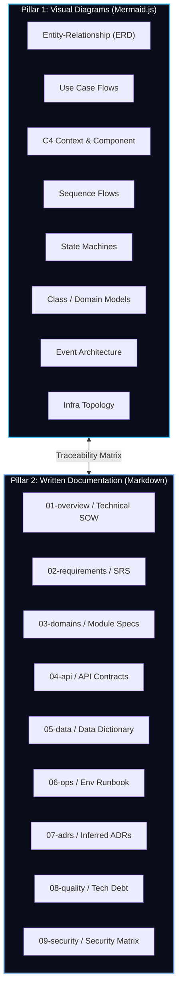

# 📐 ODG Architecture Suite

Open Docs Gen (`odg`) organizes software architecture into two complementary, synchronized pillars: **Visual Diagrams (Mermaid.js)** and **Written Documentation Specifications (Markdown)**.



---

## Pillar 1: Visual Diagrams (Mermaid.js v11)

All diagrams are rendered natively in Mermaid v11 with custom high-contrast dark-mode styling (`#090e1a` background, `#38bdf8` cyan accents, `#60a5fa` sky blue lines, and `#131b2e` node containers).

| Diagram Key | Diagram Name | Recommended | Description & Target Elements |
| :--- | :--- | :---: | :--- |
| `erd` | **Entity Relationship Diagram (ERD)** | ✅ Yes | Database tables, column types, PK/FK constraints, and cardinality (`\|\|--o{`). Hollow rings ensure text labels are never obscured. |
| `use_cases` | **Use Case Diagram** | ✅ Yes | Bounded context subgraphs and user actor stick figures / rounded nodes (`UserActor((...))`) mapped to system actions. |
| `c4_context` | **C4 Context & Component Diagram** | ✅ Yes | High-level system boundary, external identity providers (Auth0), databases, and internal API routers. |
| `sequence_flows` | **Sequence Flows** | ✅ Yes | End-to-end request/response lifelines with autonumbering, compensating rollback actions, and `alt/else` blocks. |
| `state_machines` | **State Machines (Statecharts)** | Enterprise | Entity state transitions, guard conditions, and terminal states (e.g. order statuses, subscription lifecycles). |
| `class_domain` | **Class & Domain Model** | Enterprise | Static class hierarchies, abstract repository interfaces (`contracts.py`), and dependency injection trees. |
| `event_flows` | **Event Architecture** | Enterprise | Event-driven triggers, background tasks, webhooks, message queues (RabbitMQ/Kafka), and async consumers. |
| `infra_topology` | **Infra Topology & Containers** | Enterprise | Docker compose topologies, cloud services, reverse proxies, and deployment architecture. |

---

## Pillar 2: Written Documentation Suite (Markdown)

Documentation files reside in `.odg/human/` and are organized in hierarchical numeric folders:

### 1. `01-overview/technical-sow.md` (Technical Scope of Work)
* **Purpose:** Executive summary, system boundaries, and deliverables.
* **Contents:**
  * Executive Summary & Purpose.
  * Verified Technology Stack Matrix (Packages, Versions, Detected Roles).
  * Implemented Capabilities by Domain Module table.
  * External Integrations & Boundary Contracts (Auth0, Third-party APIs).
  * Non-Functional Requirements & Security Boundaries.

### 2. `02-requirements/requirements-srs.md` (Software Requirements Specification)
* **Purpose:** Functional rules, actors, and business invariants.
* **Contents:**
  * Actors, Roles & Access Matrix (Anonymous, User, Admin/Coach).
  * Functional Requirements Catalog (`FR-USER`, `FR-NUTRI`, `FR-TRAIN`, `FR-ASSESS`).
  * Non-Functional Requirements (`NFR-SEC`, `NFR-RES`, `NFR-API`).

### 3. `03-domains/<module>.md` (Deep Module Specifications)
* **Purpose:** Module-by-module architectural breakdown.
* **Contents:**
  * Module Executive Summary.
  * Architecture & Design Patterns (Repository Pattern, Compensating Transactions).
  * Dedicated Mermaid Suite: C4 Component, ERD, Use Cases, Sequence Flow.
  * Component & Source File Map.

### 4. `04-api/api-contracts.md` (API & Contract Catalog)
* **Purpose:** REST / GraphQL / gRPC endpoint contracts.
* **Contents:**
  * Endpoints Overview table grouped by router (Method, Path, Auth Guard, Request DTO, Response, Status Code).
  * Error Handling Matrix & HTTP status codes.

### 5. `05-data/data-dictionary.md` (Database & Data Dictionary)
* **Purpose:** Relational schema specification.
* **Contents:**
  * Schema & Migration summary (SQLAlchemy 2.0, Alembic, PostgreSQL).
  * Table Specifications with Column, Data Type, Nullable, PK/FK, and Field Descriptions.
  * Database Indexes & Unique Constraints.

### 6. `06-ops/env-runbook.md` (Operational Runbook & Environment)
* **Purpose:** Developer onboarding and operational runbook.
* **Contents:**
  * Environment Variables Catalog (Type, Required, Default Value, Purpose).
  * Secrets Management & Credential Rotation.
  * Local Startup Guide & Healthcheck verification.

### 7. `07-adrs/inferred-adrs.md` (Architecture Decision Records)
* **Purpose:** Architecture decisions inferred directly from code structure, patterns, and library choices.

### 8. `08-quality/tech-debt-audit.md` (Technical Debt & Complexity)
* **Purpose:** Cyclomatic complexity, coupling hotspots, and refactoring opportunities.

### 9. `09-security/security-matrix.md` (Security & Threat Matrix)
* **Purpose:** STRIDE analysis, unguarded endpoints, and PII data flow audit.

---

## Traceability & Cross-References (`<!-- odg:refs -->`)

Every document in the suite includes a canonical cross-reference block:

```markdown
<!-- odg:refs:start -->
## 5. Cross-References & Traceability Matrix
| Requirement ID | Linked API Endpoint | Linked ERD Table | Sequence Flow | Status |
| :--- | :--- | :--- | :--- | :--- |
| [[req:FR-USER-01]] | [[api:POST /user/]] | [[tbl:user]] | [[diag:seq_user_registration]] | ✅ Verified |
<!-- odg:refs:end -->
```

Running `odg sweep` automatically parses these tags and reconciles backlinks across all documents with zero token cost.
