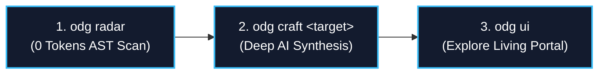

# 🚀 Getting Started with Open Docs Gen (`odg`)

Welcome to **Open Docs Gen (`odg`)** — the autonomous architecture documentation framework that transforms your codebase into a living, high-definition architecture portal with zero token waste.

---

## 1. Prerequisites

Before installing `odg`, ensure your local environment satisfies:
* **Node.js**: `v20.0.0` or higher (`node -v`)
* **Package Manager**: `npm`, `pnpm`, or `yarn`
* **Git**: Repository version control initialized in your project

---

## 2. Installation

You can install `odg` globally on your machine or locally inside your project.

### Global Installation (Recommended)
Installing globally allows you to run `odg` from any terminal and any repository on your machine:

```bash
# Using npm
npm install -g open-docs-gen

# Or using pnpm
pnpm add -g open-docs-gen
```

Verify your installation:
```bash
odg --version
# Output: 0.1.0
```

### Local Project Installation
```bash
# In your project root
npm install --save-dev open-docs-gen
# Run via npx:
npx odg --help
```

---

## 3. Initializing Your Project (`odg init`)

Navigate to the root directory of your codebase (e.g. your Python, TypeScript, Go, or Java project) and run:

```bash
odg init
```

The interactive onboarding wizard will guide you through 5 simple steps:

1. **Architecture Preset Selection:**
   * **⚡ Recommended Standard:** Core diagrams (ERD, Use Cases, C4, Sequence) + Essential docs (SOW, SRS, APIs, Data Dictionary, Runbook).
   * **🏢 Full Enterprise:** All 8 diagrams + All 9 documents (ADRs, Tech Debt Audit, Security Matrix).
   * **🚀 Lean / MVP:** C4, ERD + Technical SOW, Module Specs, and Runbook.
   * **🎛️ Custom:** Cherry-pick individual diagrams and written documents.
2. **Visual Diagrams (Mermaid.js):** Select the diagrams to generate.
3. **Written Documentation (Markdown):** Select the technical specs to enable.
4. **Knowledge Base Sweep Mode:** Configure cross-document linking (`auto_zero_token` by default).
5. **AI Tools & CLI Integrations:** Select your AI assistants (**Antigravity CLI `agy`**, **Claude Code**, **GitHub Copilot**, etc.) to install native skills and slash commands.

Upon completion, `odg init` creates:
* `.odg/blueprint.json`: Your active configuration schema.
* `.odg/human/`: Scaffolded directories ready for architectural synthesis.
* Native AI integration files in `.agents/`, `.claude/`, or `.github/`.

---

## 4. The 3-Step Core Workflow



### Step 1: Scan & Discover (`odg radar`)
Run the 0-token AST scanner to discover modules, bounded contexts, and token weights:
```bash
odg radar
```
* Identifies all modules in `src/`.
* Computes file counts and token estimates.
* Generates `.odg/radar-manifest.json`.

### Step 2: Synthesize Documentation (`odg craft`)
Document a specific module, a global specification, or the entire codebase:
```bash
# Document a specific domain module
odg craft user

# Document a global specification
odg craft sow

# Or synthesize the entire suite in one pass
odg craft --all
```

### Step 3: Launch Living Portal (`odg ui`)
Launch the embedded dark-mode documentation portal:
```bash
odg ui
```
Open **`http://localhost:4321`** in your browser to inspect high-definition Mermaid diagrams, zoom into lifelines and schemas with interactive pan & zoom, and browse technical specifications.

---

## 5. Next Steps

* 📖 Explore the [CLI Command Reference](cli-reference.md) for full argument details.
* 🤖 Learn how to use AI slash commands in [AI Integrations Guide](ai-integrations.md).
* 📐 Read about the diagram and document catalog in [Architecture Suite](architecture-suite.md).
* 🌐 Discover portal features and visual contrast guarantees in [Portal Guide](portal-guide.md).
